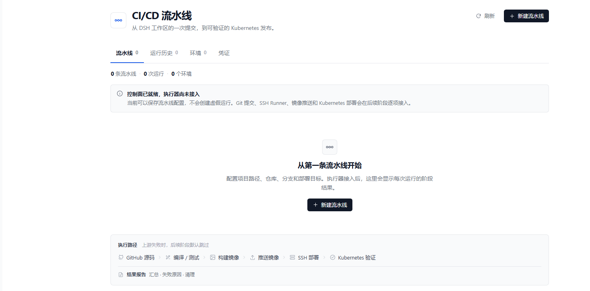

# UI 设计：阶段、页面与状态

## 设计目标

- 白色、轻量、管理型界面，不使用外部 UI 框架。
- 每个页面都先回答三个问题：**当前配置是什么、执行到哪一步、失败/等待的原因是什么。**
- 不显示假数据、假成功或未实现的执行按钮结果。

## 信息架构

```text
侧边栏：CI/CD 流水线
└─ 主页面
   ├─ 流水线
   │  ├─ 空态 / 列表
   │  ├─ 新建 / 编辑
   │  └─ 详情：阶段图、阶段详情、配置摘要、最近运行
   ├─ 运行历史
   │  └─ 空态 / 列表 / 运行详情
   ├─ 环境
   │  ├─ 构建环境（规划态）
   │  └─ 部署环境（规划态）
   └─ 凭证
      ├─ GitHub
      ├─ 镜像仓库
      └─ SSH
```

## 六个主阶段与结果报告

| 阶段 | 节点信息 | 职责 | 后续运行将记录 |
|---|---|---|---|
| GitHub 源码 | 状态 · 提交 · 推送 · SHA | 检查仓库/分支/变更，敏感文件拦截，提交推送，锁定 SHA | Commit SHA、分支、退出码、脱敏 Git 日志 |
| 编译 / 测试 | SSH Runner · 精确 SHA | 远端精确 checkout、语言识别、工具链容器、编译/测试 | Runner、语言、工具链、子步骤耗时、退出码 |
| 构建镜像 | Dockerfile · Buildx | 已有 Dockerfile 优先，按语言生成模板，生成可追溯标签 | Dockerfile 路径、后端、标签、耗时 |
| 推送镜像 | Registry · digest | 远端登录、推送、记录完整引用与 digest | 镜像地址、digest、认证结果、耗时 |
| SSH 部署 | Helm / kubectl · 审批 | 独立部署环境、严格主机密钥、Helm/kubectl/模板、审批 | 目标/context、namespace/release、策略、审批 |
| Kubernetes 验证 | rollout · Pod · 镜像 | rollout 状态、Pod、实际镜像/digest | rollout、Pod、实际镜像、耗时 |
| 结果报告 | 汇总 · 失败原因 · 清理 | 汇总阶段结果、错误、清理状态（失败时仍生成） | 阶段矩阵、错误码、清理状态、日志 |

结果报告不是“第七个部署步骤”，而是阶段图的终端汇总条。它不能把失败改写成成功。

## 状态

| 状态 | 显示 | 使用位置 |
|---|---|---|
| `pending` | 等待 | 已被运行创建、尚未开始 |
| `running` | 运行中 | 当前阶段 |
| `succeeded` | 成功 | 终态 |
| `failed` | 失败 | 终态，带错误码/原因 |
| `skipped` | 跳过 | 上游失败/审批拒绝 |
| `cancelled` | 已取消 | 用户取消 |
| `interrupted` | 已中断 | DSH 重启恢复 |
| `not_run` | 未运行 | 还没有运行记录 |

运行状态另含 `queued`、`awaiting_approval`、`cancelling`。

## 页面说明

### 流水线列表

- 列：流水线/项目、仓库/分支、项目类型、Commit、镜像、目标、最近运行、更新时间、编辑。
- 没有运行时，Commit/镜像显示 `—`，最近运行显示 **未运行**，不显示 0 秒成功。
- 空态展示六阶段路径和创建入口，解释上游失败时后续默认跳过。

> 以下截图展示空状态；列表、表单和运行详情使用同一套字号/间距规则渲染。



### 创建/编辑

- 分组：基础信息、源码、构建与镜像、部署目标。
- 只保存非敏感配置；令牌/私钥/密码留给凭证页。
- 构建 section 支持 **检测语言**、候选/证据选择、**预览构建计划**、工具/版本/命令/Dockerfile 路径；保存后随流水线持久化。
- 表单校验：名称必填；项目路径必须绝对；仓库 URL 不允许带用户名/密码；namespace/release 使用小写 DNS label；custom 项目必须有 build/test 命令。

### 流水线详情

- 头部：名称、最近状态、项目类型、仓库/分支/路径。
- 操作：刷新、编辑、运行（当前禁用并显示原因）。
- 阶段图：六个主节点横向排列，连接箭头表示顺序；点击节点查看职责和将记录的信息。
- 结果报告条：在阶段图下方，点击同样可查看说明。
- 下方两栏：阶段详情 + 最近运行；右侧配置摘要、Runner 状态、结果报告说明。
- 有运行时，阶段图使用真实 stage 状态、开始/结束/耗时/退出码；没有运行时一律显示“未运行”，不伪造 pending 进度。

### 运行历史 / 运行详情

- 历史表保留 Commit、镜像、目标、Runner、状态、时间。
- 运行详情支持阶段图、阶段详情和按阶段日志。
- 日志读取已预留轮询与脱敏接口；当前没有执行器，因此为空态。

### Git 源码面板（P2）

顶部新增 **Git 源码** Tab，不需要先创建流水线：

- 从 **DSH 工作区** 列表选择，或手填本地 Git 仓库绝对路径。
- **目标仓库** 可留空（使用 origin），也可填写独立的 GitHub 地址。
- 点击 **打开 Git 操作** 进入面板。
- 也可以从流水线详情点击 **Git 源码** 进入，自动带入项目路径/仓库，返回时回到该流水线详情。

进入 Git 面板后：

- 顶部摘要：仓库、当前分支、upstream、HEAD、ahead/behind、工作区是否干净。
- 文件列表：M/A/D/R/U 状态、路径、复选框；敏感文件禁用并标记“阻止”。
- 点击文件查看 diff；敏感文件的 diff 不返回，避免暴露秘密。
- 右侧提交区：提交信息、推送分支（datalist）、预览提交。
- 预览后出现确认卡：选中文件数、推送分支、确认/取消。
- 提交成功后显示 Commit SHA、远端 SHA、推送分支和远端校验结果。
- 底部可折叠的 GitHub 认证：保存/更换/清除 Token，永不回显值。

### 环境

- 构建环境与部署环境分成两张卡，明确“构建机与部署目标分开配置”。
- 构建机以可折叠列表项呈现：摘要显示 host/user/保存状态，展开后编辑主机、认证和远端目录。
- 构建环境已接入 **SSH 预检**：主机/端口/用户/认证（agent、key、用户名+密码）、known_hosts、期望指纹、远端工作目录、Git/Docker/Buildx/磁盘检查；非敏感主机配置持久化到 SQLite。
- 用户名+密码模式把密码保存到 DSH credentials（`DSH_CICD_SSH_PASSWORD`），预检只传引用；密码不回显。
- 部署环境仍是 P6：kubectl/context/namespace、Helm、生产审批。
- 构建机卡片明确提示“预检不执行 build”；真实 build 在 P4 后半段接入。

### 凭证

- **GitHub** 卡片已接入：状态徽章显示已配置/未配置，可直接保存、更换、清除 PAT；值不回显。
- 镜像仓库、SSH 仍是 P4/P6 规划态，显示“未接入”，不会假装可保存。
- 页面底部保留“为什么凭证单独管理”的说明：配置只存引用，值走 DSH credentials。

## 视觉规范

- 页面背景：`#fff`；边框：`#e5e7eb`；次级背景：`#f9fafb`。
- 主文字：`#111827`；次级文字：`#6b7280`。
- 强调色：`#2563eb`（只用于选中态和链接）；主按钮：`#111827`（深色，避免与成功语义混淆）。
- 成功 `#15803d`、警告 `#a16207`、失败 `#b91c1c` 只用于状态文字/圆点，不做大面积色块。
- 基础字号：正文 14px；表单输入 14px；表格 13px；标签 13px；说明 12px；页面标题 26px。
- 阶段不再使用多色区分；六阶段保持中性，选中时使用蓝色描边，状态只通过文字和颜色点表达。
- 圆角：卡片 10px、控件 6–7px；不使用重阴影。
- 页面固定浅色，作为独立管理面板；控件仍继承 DSH 的字体和基础交互习惯。

## 可访问性

- 阶段节点是原生 `button`，支持键盘 Enter/Space。
- 焦点可见（`:focus-visible`）。
- 状态文本与颜色同时存在。
- 表格行可点击，但编辑按钮阻止事件冒泡。
- 空态/错误态有明确文本，不依赖图标。

## 刷新/重启行为

- 页面数据每次通过认证 API 读取 SQLite，不依赖 React 内存。
- 启动恢复把 `queued/running/awaiting_approval/cancelling` 运行改为 `interrupted`。
- 当前 P0/P1 刷新后仍会回到“流水线”Tab；运行详情/深链导航在后续阶段补齐。
